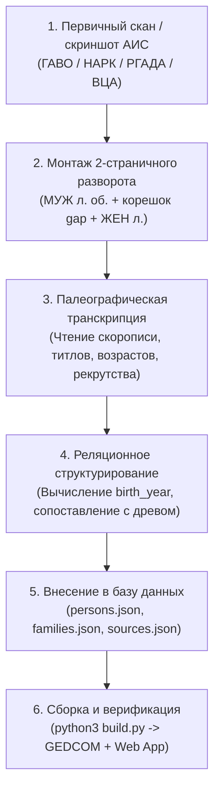

# ТЕХНОЛОГИЧЕСКИЙ ПАЙПЛАЙН: СКАНИРОВАНИЕ, РАСПОЗНАВАНИЕ И ВНЕСЕНИЕ В БАЗУ

Настоящее руководство регламентирует полный цикл работы с архивными первоисточниками проекта: от первичного цифрового снимка до интерактивного отображения в веб-древе.



---

## ЭТАП 1. Сканирование и графическая сборка разворота

### 1.1. Исходные материалы
- Сканы поступают из архивных информационных систем (АИС ЭЛАР ГАВО, АИС ЦАМО, сканы РГАДА, микрофильмы ВЦА).
- Часто исходные файлы представляют собой раздельные кадры:
  - Кадр 1: Четный лист (`л. об.`) — Мужеский пол.
  - Кадр 2: Нечетный лист (`л.`) — Женский пол.

### 1.2. Стандарт сборки двухстраничного разворота (`Full 2-Page Spread`)
1. **Категорический запрет на полосные обрезки:** запрещено вырезать узкие полоски по отдельным дворам.
2. **Параметры холста:** `2200 × 1960 px` (RGB, фон пергамента `#dedede` – `#ececec`).
3. **Левая страница:**
   - Полный лист Мужеского пола (размер `1080 × 1620–1900 px`).
   - Размещается с отступом `x = 10 px`, `y = 10..30 px`.
4. **Центральный книжный переплет (`gap`):**
   - Ширина разделителя: `20–30 px` (`x = 1090..1110 px`).
   - Наложение градиентной тени корешка книги (центральные пиксели имеют затенение с переходом к краям страниц).
5. **Правая страница:**
   - Полный лист Женского пола (размер `1080 × 1620–1900 px`).
   - Размещается с отступом `x = 1110 px`.
6. **Генерация миниатюры:** сохранение Web-оптимизированного превью в каталог `превью/` (ширина `320–400 px`).

---

## ЭТАП 2. Палеографическое распознавание и расшифровка скорописи

### 2.1. Чтение реквизитов документа
- **Шапка документа:** номер сказки (например, *«Сказка № 12»*), название волости и селения (*«Коквицкого селения»*, *«деревни Ероздинской»*).
- **Номер двора:** номер семьи по текущей и предыдущей ревизиям (например, *«Семья № 158 / по ревизии 1811 г. № 150»*).

### 2.2. Расшифровка граф Мужеского пола (`л. об.`):
1. **ФИО и статус:** глава семьи, сыновья, братья, племянники, приемыши.
2. **Возраст по прошлой ревизии:** графа «В последнюю ревизию состояло».
3. **Причина и дата убыли:** графа «Из того числа после ревизии выбыло»:
   - *«умре в 1814 году»*
   - *«Рекрутъ 1812 года»* / *«Рекрутъ 1813 года»*
   - *«Былъ въ стрѣлкахъ въ ратникахъ»* (Вологодское ополчение 1812 г.)
   - *«переведен въ деревню...»*
4. **Возраст на момент переписи:** графа «Ныне налицо».
   - Для родившихся между ревизиями: *«вновь рожденный — 1 год / 2 года»*.

### 2.3. Расшифровка граф Женского пола (`л.`):
1. **Степень родства к главе семьи:**
   - *«Григорья Степанова жена Матрена — 63 года»*
   - *«Его же дочери: Наталья — 12 лет, Ирина — 6 лет»*
   - *«Сына его Василья жена Авдотья — 25 лет»*
   - *«Свояченица Пелагия — 70 лет»* (сестра супруги, внимательно отличать от «падчерицы»!).
2. **Возраст женщин:** фиксируется только на момент текущей переписи.

### 2.4. Вычисление расчетных дат:
$$\text{Год рождения} \approx \text{Год ревизии} - \text{Возраст}$$
*Пример:* Алексей Григорьев Туркин — в ревизии 1816 г. указан 38 лет $\rightarrow$ год рождения ок. $1816 - 38 = 1778$ г. (в 1811 г. указан 34 года $\rightarrow 1811 - 34 = 1777$ г., согласованность 100%).

---

## ЭТАП 3. Внесение распознанной информации в базу данных

### 3.1. Регистрация источника в `data/sources.json` и `archive_catalog.py`
```json
{
  "id": "revision_1816_turkin_158",
  "title": "7-я ревизия 1816 г.: Семья Туркиных с. Коквицы (двор № 158, лл. 352 об. – 353)",
  "personId": "I80",
  "personIds": ["I80", "I368", "I369", "I370", "I371", "I372", "I373", "I374", "I375", "I376", "I377", "I378"],
  "personName": "Григорий Степанович Туркин и сыновья (двор № 158)",
  "category": "ancient",
  "categoryLabel": "Ревизии и переписи",
  "badge": "7-я ревизия (Коквицы, лл. 352 об. – 353)",
  "badgeColor": "#059669",
  "date": "1816 год",
  "archive": "ГАВО, фонд 388, опись 9, дело 201, лл. 352 об. – 353 (двор № 158)",
  "award": "7-я Государственная подушная ревизия",
  "file": "архив_сканы_первоисточников/1816_crops/kokvitsy_spread_352ob_353.jpg",
  "thumb": "превью/kokvitsy_thumb_352ob_353.jpg",
  "desc": "Полная дословная транскрипция мужской и женской половины двора..."
}
```

### 3.2. Сопоставление и создание персон в `data/persons.json`
- **Существующие персоны:** обогащаются точными датами (`birt_date`, `deat_date`), выписками в `notes` и ссылкой `source_id`.
- **Новые персоны:** получают новый `id` (например, `I438`), пол `M`/`F`, колено `gen`, ссылки `fams` и `famc`.

### 3.3. Формирование семейных связей в `data/families.json`
- Родители объединяются в семью (`husb`, `wife`).
- Дети заносятся в массив `children` в хронологическом порядке.

---

## ЭТАП 4. Автоматическая валидация и компиляция (`build.py`)

После внесения данных запускается единый сборочный конвейер:
```bash
python3 build.py
```
Конвейер автоматически:
1. Проверяет реляционную целостность базы данных (`data_manager.py`).
2. Рассчитывает координаты новых персон и проверяет древо на отсутствие геометрических коллизий (`layout_engine.py`).
3. Экспортирует стандартизированный файл GEDCOM 5.5.1 (`rodoslovnaya_turkin.ged`).
4. Генерирует интерактивные веб-приложения (`index.html`, `tree.html`, `родословная.html`).
